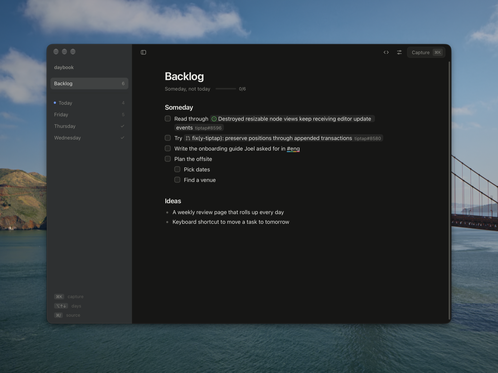
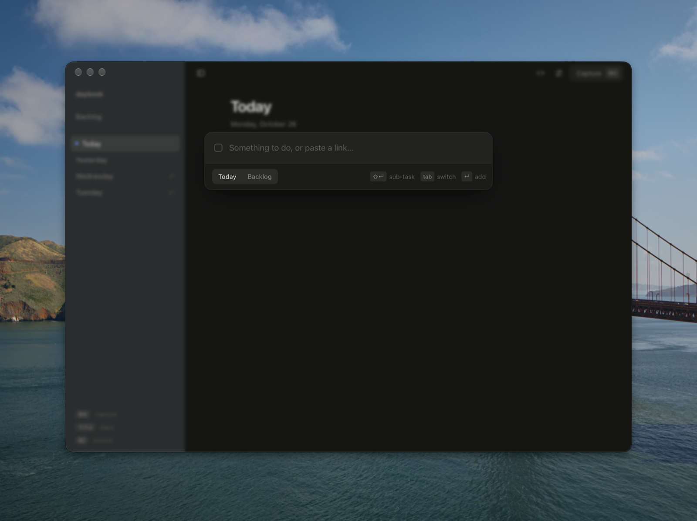
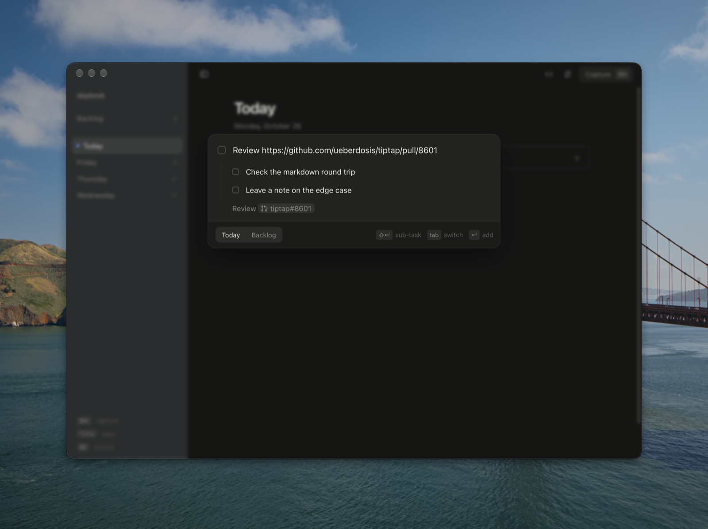
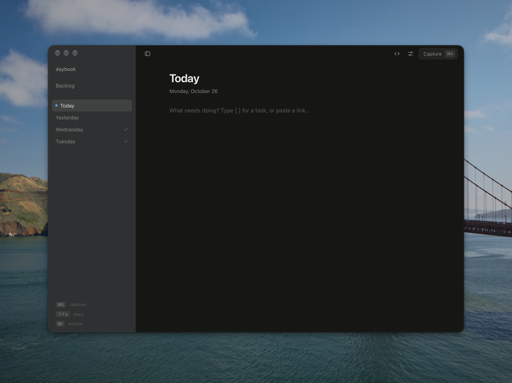
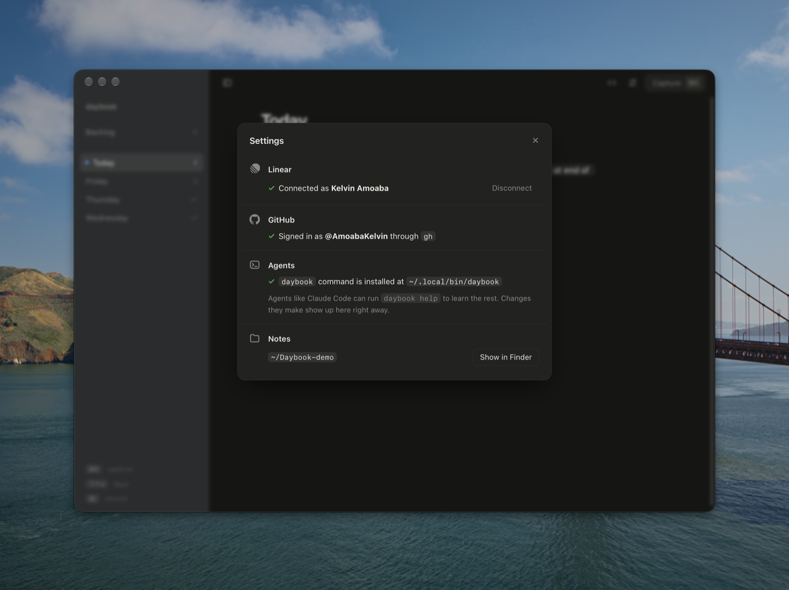

# daybook

A small daily notes app for the things you need to work on. You write markdown and it renders as you type.



- Each day gets its own page, plus one Backlog page for later
- `[ ] ` or `- [ ] ` starts a task list
- Paste a GitHub PR or issue link and it becomes a chip with the title and a live status color (open, draft, merged, closed). Titles come from your `gh` login, so private repos work too
- When a linked PR merges, or a linked issue closes, its task ticks itself off. Untick it and it stays unticked
- Paste a Slack message link and it shows the four-color Slack underline. Click any link to open it
- Linear issue links show their title and status (triage, backlog, todo, in progress, done, canceled) once you add an API key in Settings (`⌘,`). The key is stored in your Keychain
- `⌘K` captures a task from anywhere in the app. `⇧↵` adds a sub-task under it, and `tab` switches between Today and Backlog
- `⌥Space` opens the same capture box over any app, so you can grab something from Slack without switching windows. Change or turn off the shortcut in Settings
- The menu bar icon shows how many tasks are open today. Its menu lists them so you can tick them off, and has quick capture
- When today is empty, it offers to bring over the most recent day's unfinished tasks
- Tasks you bring over are marked moved (`- [>] `) on the day they came from, so that day reads as finished

## Capture

`⌘K` opens a small box over whatever you're looking at, and `⌥Space` opens it over any other app too. Paste a link and it shows how the chip will look before you add it.

<p>
  
  
</p>

## A new day

Each morning starts with an empty page. If the last day still has open tasks, one click brings them over.

<p>
  
  
</p>

## Settings

Linear, GitHub, the `daybook` command and the notes folder, in one place.



## Run

```sh
pnpm install
pnpm app:build  # builds src-tauri/target/release/bundle/macos/Daybook.app
pnpm app        # the Mac app in dev mode, with hot reload
pnpm dev        # the same UI in a browser at http://localhost:4321
```

To update the installed app, run `pnpm app:build` and copy `Daybook.app` into `/Applications`. Building needs Rust (`rustup`).

Closing the window hides it, and clicking the Dock icon brings it back. `⌘Q` saves any pending edit before it quits.

Notes are saved as plain markdown in `~/Daybook/YYYY-MM-DD.md` (plus `backlog.md`). Set `DAYBOOK_DIR` to use a different folder.

## Agents and the command line

The app binary is also a `daybook` command. Settings → Agents → Install links it at `~/.local/bin/daybook`. Agents like Claude Code can run `daybook help` to learn it:

```sh
daybook add Review https://github.com/acme/api/pull/42     # to today
daybook add Plan the offsite --backlog
daybook tasks --open
daybook done 2                                              # or: daybook done auth fix
daybook days
```

The app watches `~/Daybook`. When the CLI, an agent or another editor changes a note, the app shows the change straight away. If you're typing in that note at the same time, both sets of edits are merged.

## Keys

| | |
|---|---|
| `⌘K` | capture |
| `⌘J` | assigned to you (GitHub and Linear) |
| `⌥Space` | capture from any app |
| `⇧↵` | add a sub-task while capturing |
| `⌥↑` / `⌥↓` | previous / next day |
| `⌘/` | toggle markdown source |
| `⌘\` | toggle sidebar |
| `⌘,` | settings |

## License

MIT
